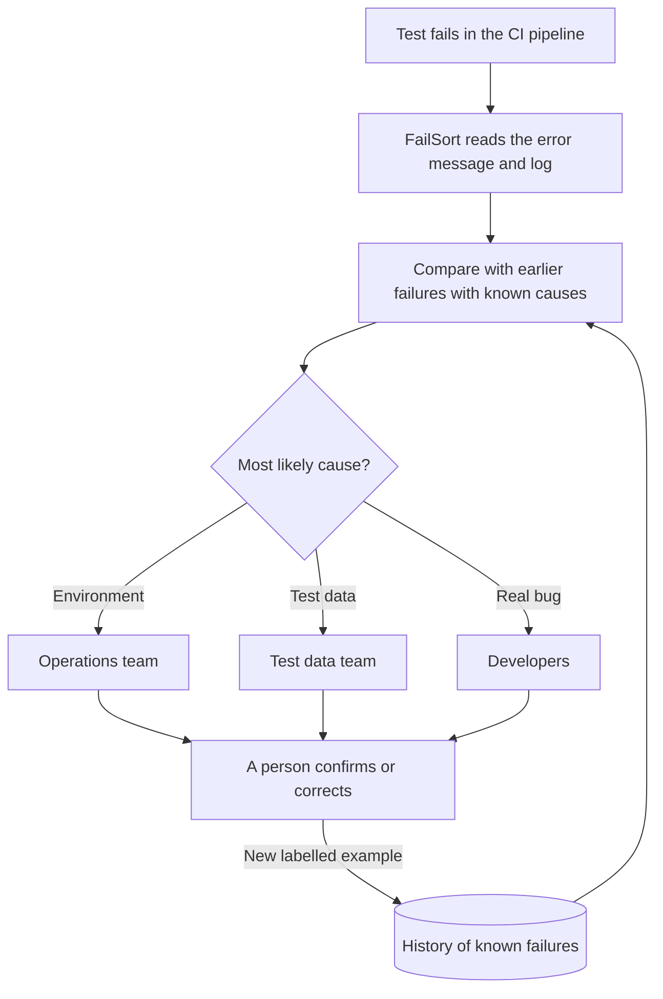

# FailSort – AI triage for failed software tests

*Building AI course project*

## Summary

FailSort is an AI assistant that reads the log of a failed software test and predicts why it failed: a broken test environment, bad test data or a real bug. The failure is then routed to the right team at once, instead of bouncing between teams.

## Background

Modern software is tested automatically. Every time the code changes, a *CI pipeline* (continuous integration) runs hundreds or thousands of automated tests. When a test fails, someone has to answer a simple but time-consuming question: **why did it fail – and who should fix it?**

Most failures fall into one of three groups:

| Cause | Example | Who should fix it |
|---|---|---|
| 🔧 **Test environment** | A database, server or integration in the test environment is down or misconfigured | Operations team |
| 📦 **Test data** | The test needs a customer, account or product that is missing, expired or already used by another test | Test data team |
| 🐞 **Real bug** | The software itself calculates or behaves wrongly | Developers |

Problems this causes:

* Error messages look alike, so failures are sent to the wrong team and bounce back and forth.
* Real bugs drown in noise from environment and data problems.
* When tests often fail for reasons unrelated to the code, people start ignoring red test results – and real bugs slip through.

**How common is it?** Common – even at Google. There, almost 16 % of tests have some level of *flakiness* (they sometimes fail without any change in the code), and about 84 % of the transitions from pass to fail involve a flaky test ([Google Testing Blog, 2016](https://testing.googleblog.com/2016/05/flaky-tests-at-google-and-how-we.html)). In other words, a failed test often does not mean a real bug – but someone still has to find out.

**My motivation:** I work with test environments and test data. The question *"is it the environment, the data or the code?"* comes up all the time, and answering it is mostly manual detective work. I want to explore how much of that work AI can take over, so that people can spend their time fixing problems instead of finding out whose problem it is.

## How is it used?

FailSort runs in the background of the CI pipeline:

1. A test fails.
2. FailSort reads the error message and log of the failed test.
3. It compares the log with earlier failures where the cause is already known.
4. It suggests the most likely cause, with a short explanation, and sends the failure to the right team.
5. A person confirms or corrects the suggestion. Every confirmed answer becomes a new training example, so FailSort gets better over time.



Example of what FailSort could show (fictional data):

| Failed test | Error message | Suggested cause | Why? |
|---|---|---|---|
| `test_login` | `Connection refused: auth-service` | 🔧 Environment | 5 of the 5 most similar earlier failures were environment problems |
| `test_invoice` | `Customer not found in test database` | 📦 Test data | 4 of 5 were test data problems |
| `test_discount` | `Expected total 90.00 but was 100.00` | 🐞 Real bug | 3 of 5 were real bugs |

**Who uses it, and who is affected?**

* **Testers and test managers** spend less time sorting failures by hand.
* **Developers** get real bugs and fewer false alarms.
* **Operations teams** hear about environment problems sooner.
* **Test data teams** see which data sets cause problems most often.
* **Managers** get an overview of where time is lost.
* **End users** benefit indirectly: bugs are fixed faster and fewer reach production.

FailSort should support people, not judge them. It must never be used to rank or blame individuals or teams, and a person always makes the final decision.

## Data sources and AI methods

**Data**

* **Test results** from the CI system: test name, error message, log, time and test environment.
* **Resolved issues** from the issue tracker (for example Jira), where the real cause was recorded. These are the labels – the "answer key" the model learns from.
* **Optional context:** recent deployments to the environment, which test data set was used, time of day.

Before use, the logs are cleaned: personal data, passwords and tokens are masked, and variable parts such as IDs and timestamps are replaced with placeholders. That way *"Customer 4711 not found"* and *"Customer 1234 not found"* are treated as the same message.

**AI methods** – all covered in the Building AI course:

| Step | Method | Why |
|---|---|---|
| Text → numbers | Bag of words / TF-IDF | Turns each log into a vector. Rare, telling words such as *timeout* or *not found* weigh more than common ones. |
| Classification | k-nearest neighbours (supervised learning) | Finds the *k* most similar earlier failures and lets them vote. Easy to explain: "this looks like these five earlier failures". |
| Validation | Train/test split and cross-validation | Checks that the model works on new failures, not just on ones it has memorised (overfitting), and helps choose *k*. |
| Baseline | Always guess the most common cause | If 60 % of all failures are environment problems, the model must beat 60 % accuracy to be useful. Precision and recall per cause are reported too. |
| Later | Logistic regression, neural networks, embeddings | Compared against k-NN. Embeddings capture meaning, so *"connection refused"* and *"host unreachable"* end up close together. |

**Proof of concept** – a toy example in Python with [scikit-learn](https://scikit-learn.org/) and fictional log messages:

```python
from sklearn.feature_extraction.text import TfidfVectorizer
from sklearn.neighbors import KNeighborsClassifier

# Fictional earlier failures where the cause is already known
logs = [
    "Connection refused: database host unreachable",
    "Timeout while connecting to payment service",
    "HTTP 503 Service Unavailable from login service",
    "SSL certificate expired on test server",
    "Customer not found in test database",
    "Account is locked or already used by another test",
    "Product code missing from test data set",
    "Test user password expired",
    "AssertionError: expected total 120.00 but was 0.00",
    "NullPointerException in invoice calculation",
    "Expected status APPROVED but was REJECTED",
    "IndexError: list index out of range in discount rule",
]
causes = ["environment"] * 4 + ["test data"] * 4 + ["bug"] * 4

# 1. Turn the log texts into TF-IDF vectors
vectorizer = TfidfVectorizer()
x = vectorizer.fit_transform(logs)

# 2. k-nearest neighbours: the 3 most similar earlier failures vote
knn = KNeighborsClassifier(n_neighbors=3, metric="cosine")
knn.fit(x, causes)

# 3. Predict the cause of new failures
new_failures = [
    "Timeout when connecting to database host",
    "Test customer not found",
    "AssertionError: expected discount 10 but was 0",
]
predictions = knn.predict(vectorizer.transform(new_failures))
for log, cause in zip(new_failures, predictions):
    print(f"{cause:12} <- {log}")
```

Output:

```text
environment  <- Timeout when connecting to database host
test data    <- Test customer not found
bug          <- AssertionError: expected discount 10 but was 0
```

## Challenges

FailSort does **not** solve everything:

* **It fixes nothing by itself.** It only suggests where to look and who should look.
* **New kinds of failures** with no history will be guessed poorly. FailSort must be able to say *"I'm not sure"* – for example when the nearest neighbours disagree – and leave the case to a person.
* **Garbage in, garbage out.** If causes were recorded inconsistently in the past, or one team was blamed out of habit, the model learns the same mistakes.
* **Mixed causes.** A failure can have more than one cause, for example bad test data created by an environment problem.
* **Privacy and security.** Logs can contain personal data or secrets. They must be masked, and test environments should only use synthetic or anonymised data (GDPR).
* **Systems change.** After major upgrades, old examples may no longer fit, so the model must be retrained regularly.
* **Over-trust.** If the tool is usually right, people may stop thinking critically. A person always makes the final decision.

## What next?

* **Pilot:** collect an anonymised data set from one team and measure accuracy against the baseline.
* **Integration:** connect FailSort to the CI pipeline and the issue tracker, so failures are labelled and routed automatically.
* **Smarter search:** use embeddings and a vector database (for example OpenSearch k-NN) to find failures with similar *meaning*, not just similar words.
* **Suggested fixes (RAG):** show how similar failures were solved before, using runbooks and earlier tickets.
* **Safe first aid:** an AI agent that, with human approval, re-runs a test, checks that services are up or reserves fresh test data.
* **Dashboard:** show which environments and data sets cause the most lost time, so improvements go where they matter most.

To get there, the project needs people with skills in DevOps, test data, software development and data science – collaborators are welcome!

## Acknowledgments

* Inspired by the [Building AI](https://buildingai.elementsofai.com/) course by Reaktor Innovations and the University of Helsinki, and by my own work with test environments and test data.
* README structure based on the Building AI project template.
* Statistics on flaky tests: John Micco, [*Flaky Tests at Google and How We Mitigate Them*](https://testing.googleblog.com/2016/05/flaky-tests-at-google-and-how-we.html), Google Testing Blog, 2016.
* The proof of concept uses [scikit-learn](https://scikit-learn.org/) (BSD license).
* The diagram is written in [Mermaid](https://mermaid.js.org/), which GitHub renders automatically.
* All example data in this README is fictional.
