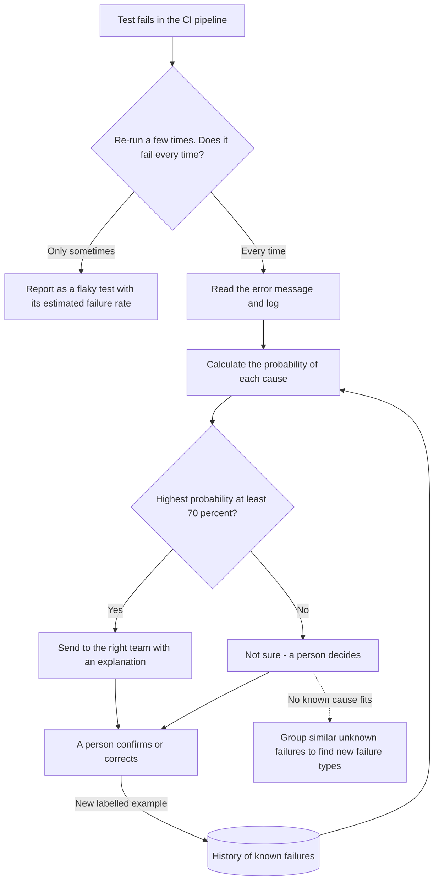

# FailSort – AI assisted assessment for failed software tests

*Building AI course project*

## Summary

FailSort is an AI assisted assessment agent that reads the log of a failed software test and predicts why it failed: a broken test environment, bad test data or a real bug. The failure is then routed to the right team at once, instead of bouncing between teams.

## Background

Modern software is tested automatically. Every time the code changes, a *CI pipeline* (continuous integration) runs hundreds or thousands of automated tests. When a test fails, someone has to answer a simple but time-consuming question: **why did it fail – and who should fix it?**

Most failures fall into one of three groups:

| Cause | Example | Who should fix it |
|---|---|---|
| 🔧 **Test environment** | A database, server or integration in the test environment is down or misconfigured | Operations team |
| 📦 **Test data** | The test needs a customer, account or product that is missing, expired or already used by another test | Test data team |
| 🐞 **Real bug** | The software itself calculates or behaves wrongly | Developers |

Problems this causes:

* Error messages look alike, so failures are sent to the wrong team and bounce back and forth.
* Real bugs drown in noise from environment and data problems.
* When tests often fail for reasons unrelated to the code, people start ignoring red test results – and real bugs slip through.

**How common is it?** Common – even at Google. There, almost 16 % of tests have some level of *flakiness* (they sometimes fail without any change in the code), and about 84 % of the transitions from pass to fail involve a flaky test ([Google Testing Blog, 2016](https://testing.googleblog.com/2016/05/flaky-tests-at-google-and-how-we.html)). In other words, a failed test often does not mean a real bug – but someone still has to find out.

**What makes FailSort different?** Commercial test platforms are starting to add AI agents for similar tasks, such as grouping failed tests and spotting flaky tests. FailSort is designed to be:

* **Vendor-neutral** – works with any CI tool and issue tracker.
* **Explainable** – every suggestion comes with a probability and the earlier failures it is based on.
* **Honest about uncertainty** – below 70 % confidence it says *"I'm not sure"* and lets a person decide.
* **Private** – runs inside the organisation, on masked logs.

**My motivation:** I work with test environments and test data, where problems caused by the environment, the data and the code meet. I want to find out how much of the sorting work AI can take over – and to make the answer explainable, so that people can trust it.

## How is it used?

1. A test fails in the CI pipeline.
2. **Flaky check:** FailSort re-runs the test a few times. If it fails only sometimes, it is reported as a flaky test with an estimated failure rate.
3. If it fails every time, FailSort reads the error message and the log.
4. It calculates the probability of each cause: environment, test data or real bug.
5. **70 % or more:** the failure is sent to the right team with a short explanation. **Below 70 %:** FailSort says *"I'm not sure"* and a person decides.
6. A person confirms or corrects the result. Every confirmed answer becomes a new training example, so FailSort gets better over time.
7. Failures that fit no known cause are grouped together, so new kinds of problems are discovered early.



Example of what FailSort could show (fictional data):

| Failed test | Error message | Suggested cause | Probability | Next step |
|---|---|---|---|---|
| `test_login` | `Connection refused: auth-service` | 🔧 Environment | 93 % | Sent to the operations team |
| `test_invoice` | `Customer not found in test database` | 📦 Test data | 88 % | Sent to the test data team |
| `test_discount` | `Expected total 90.00 but was 100.00` | 🐞 Real bug | 81 % | Sent to the developers |
| `test_export` | `Request failed` | ❓ Not sure | 41 % | A person decides |
| `test_search` | Passed 7 of 10 re-runs | 🎲 Flaky test | ≈ 30 % failure rate | Flaky test report |

**Who uses it, and who is affected?**

* **Testers and test managers** spend less time sorting failures by hand.
* **Developers** get real bugs and fewer false alarms.
* **Operations teams** hear about environment problems sooner.
* **Test data teams** see which data sets cause problems most often.
* **Managers** get an overview of where time is lost.
* **End users** benefit indirectly: bugs are fixed faster and fewer reach production.

FailSort should support people, not judge them. It must never be used to rank or blame individuals or teams, and a person always makes the final decision.

## Data sources and AI methods

**Data**

* **Test results** from the CI system: test name, error message, log, time and test environment.
* **Resolved issues** from the issue tracker (for example Jira), where the real cause was recorded. These are the labels – the "answer key" the model learns from.
* **Optional context:** recent deployments to the environment, which test data set was used, time of day.

Before use, the logs are cleaned: personal data, passwords and tokens are masked, and variable parts such as IDs and timestamps are replaced with placeholders. That way *"Customer 4711 not found"* and *"Customer 1234 not found"* are treated as the same message.

**How the probability is calculated – Bayes' rule in practice**

Before FailSort reads the log, history says that 60 % of all failures are environment problems. The *prior odds* are 60 : 40 = 1.5. The word *timeout* appears 9 times more often in environment failures than in other failures, so the *likelihood ratio* is 9. Bayes' rule in odds form gives:

> posterior odds = likelihood ratio × prior odds = 9 × 1.5 = 13.5

Odds of 13.5 : 1 mean a probability of 13.5 / 14.5 ≈ **93 %** that the failure is an environment problem. A *naive Bayes classifier* does the same for every word in the log and combines the evidence.

**AI methods** – all covered in the Elements of AI and Building AI courses:

| Step | Method | Why |
|---|---|---|
| Text → numbers | Bag of words / TF-IDF | Turns each log into numbers. Rare, telling words such as *timeout* or *not found* weigh more than common ones. |
| Probability of each cause | Naive Bayes classifier (supervised learning) | Gives a probability, not just a guess. Below 70 %, a person decides. |
| Explanation | k-nearest neighbours | Shows the most similar earlier failures: "this looks like these five earlier failures". |
| Flaky tests | Monte Carlo method | Re-running a test and counting the results estimates its failure rate. More runs give a more precise estimate. |
| New failure types | Unsupervised learning (clustering) | Groups unknown failures without any labels, so new causes are spotted early. |
| Validation | Train/test split and cross-validation | Checks that the model works on new failures, not just on ones it has memorised (overfitting), and helps tune the 70 % threshold. |
| Baseline | Always guess the most common cause | If 60 % of all failures are environment problems, the model must beat 60 % accuracy to be useful. Precision and recall per cause are reported too. |
| Later | Logistic regression, neural networks, embeddings | Compared against naive Bayes. Embeddings capture meaning, so *"connection refused"* and *"host unreachable"* end up close together. |

**Proof of concept** – example in Python with [scikit-learn](https://scikit-learn.org/) and fictional log messages:

```python
from sklearn.feature_extraction.text import CountVectorizer
from sklearn.naive_bayes import MultinomialNB

# Fictional earlier failures where the cause is already known
logs = [
    "Connection refused: database host unreachable",
    "Timeout while connecting to payment service",
    "HTTP 503 Service Unavailable from login service",
    "SSL certificate expired on test server",
    "Customer not found in test database",
    "Account is locked or already used by another test",
    "Product code missing from test data set",
    "Test user password expired",
    "AssertionError: expected total 120.00 but was 0.00",
    "NullPointerException in invoice calculation",
    "Expected status APPROVED but was REJECTED",
    "IndexError: list index out of range in discount rule",
]
causes = ["environment"] * 4 + ["test data"] * 4 + ["bug"] * 4

# 1. Bag of words: count the words in each log
vectorizer = CountVectorizer()
x = vectorizer.fit_transform(logs)

# 2. Naive Bayes: learns how typical each word is for each cause
model = MultinomialNB().fit(x, causes)

# 3. Predict new failures - with a probability
new_failures = [
    "Timeout when connecting to database host",
    "Test customer not found",
    "AssertionError: expected discount 10 but was 0",
    "Request failed",
]
for log, probs in zip(new_failures, model.predict_proba(vectorizer.transform(new_failures))):
    best = probs.argmax()
    cause = model.classes_[best] if probs[best] >= 0.70 else "UNSURE - ask a person"
    print(f"{probs[best]:4.0%}  {cause:22} <- {log}")
```

Output:

```text
 92%  environment            <- Timeout when connecting to database host
 93%  test data              <- Test customer not found
 98%  bug                    <- AssertionError: expected discount 10 but was 0
 33%  UNSURE - ask a person  <- Request failed
```

## Challenges

FailSort does **not** solve everything:

* **It fixes nothing by itself.** It only suggests where to look and who should look.
* **Brand-new failures still need people.** Clustering can group them, but a person has to name the new cause.
* **The 70 % threshold is a trade-off.** A higher threshold means fewer wrong routings but more cases for people. It must be tuned on test data.
* **Garbage in, garbage out.** If causes were recorded inconsistently in the past, or one team was blamed out of habit, the model learns the same mistakes.
* **Mixed causes.** A failure can have more than one cause, for example bad test data created by an environment problem.
* **Re-runs cost time.** Re-running every failed test many times is expensive, so the flaky check should focus on tests that have both passed and failed before.
* **Privacy and security.** Logs can contain personal data or secrets. They must be masked, and test environments should only use synthetic or anonymised data (GDPR).
* **Systems change.** After major upgrades, old examples may no longer fit, so the model must be retrained regularly.
* **Over-trust.** If the tool is usually right, people may stop thinking critically. A person always makes the final decision.

## What next?

* **Pilot:** collect an synthetic or anonymised data set from one team and measure accuracy against the baseline.
* **Integration:** connect FailSort to the CI pipeline and the issue tracker, so failures are labelled and routed automatically.
* **Smarter search:** use embeddings and a vector database (for example OpenSearch k-NN) to find failures with similar *meaning*, not just similar words.
* **Suggested fixes (RAG):** show how similar failures were solved before, using runbooks and earlier tickets.
* **Safe first aid:** an AI agent that, with human approval, re-runs a test, checks that services are up or reserves fresh test data.
* **Dashboard:** show which environments and data sets cause the most lost time, so improvements go where they matter most.

To get there, the project needs people with skills in DevOps, test data, software development and data science – collaborators are welcome!

## Acknowledgments

* Inspired by the [Elements of AI](https://www.elementsofai.com/) and [Building AI](https://buildingai.elementsofai.com/) courses by Reaktor Innovations and the University of Helsinki, and by Kjetil Øien´s work with test environments and test data for 20 years.
* README structure based on the Building AI project template.
* Statistics on flaky tests: John Micco, [*Flaky Tests at Google and How We Mitigate Them*](https://testing.googleblog.com/2016/05/flaky-tests-at-google-and-how-we.html), Google Testing Blog, 2016.
* The proof of concept uses [scikit-learn](https://scikit-learn.org/) (BSD license).
* The diagram is written in [Mermaid](https://mermaid.js.org/), which GitHub renders automatically.
* All example data in this README is fictional.
