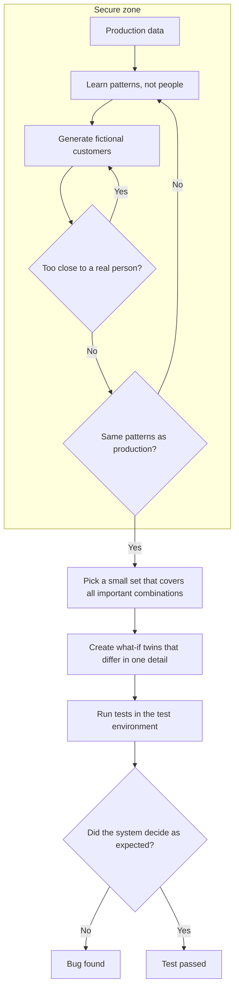

# TwinData – privacy-safe synthetic test data with "what-if" twins

*Building AI course project*

## Summary

TwinData creates realistic but fake test data, so no real customer data is needed in test environments. It also makes 'what-if' twins – records that differ in one detail only – to check that systems and AI models decide fairly and as expected.

## Background

Software must be tested with data that looks real. Today, test data is often made by copying production data and *masking* it – hiding names, ID numbers and other personal details. This has three problems:

* **Privacy risk.** Masking is complex, and one mistake can expose real people. In a 2024 survey by a data company, 54 % of organisations said they had already experienced a breach or theft of sensitive data in non-production environments such as test and development ([Perforce, 2024](https://www.perforce.com/press-releases/delphix-state-data-compliance-and-security-report-reveals)).
* **Missing edge cases.** Real data rarely contains the unusual combinations testers need – for example a 19-year-old with three claims in one year.
* **No answer to "what if?"** When systems use rules or AI to make decisions – a price, a claim, a loan – we need to check that they decide fairly. Real data cannot tell us what would have happened if one single detail had been different.

The GDPR also requires *data protection by design and by default*: by default, only the personal data that is necessary for each specific purpose should be processed ([GDPR Article 25](https://eur-lex.europa.eu/eli/reg/2016/679/oj)). This makes it hard to justify copying real customers' data into test environments when realistic fake data can do the job.

**How common is it?** Every organisation in the EU and EEA that tests software on customer data faces this – banks, insurers, public services and online shops alike.

**My motivation:** I work with test environments and test data. Getting good test data often means copying production data and masking it – slow and risky work. I want to explore how AI can make test data safe by design, so that no real person ever needs to end up in a test environment.

## How is it used?

1. **Learn patterns, not people.** Inside a secure zone, TwinData reads production data and keeps only patterns: how values are distributed and how they relate – for example how often young customers buy travel insurance.
2. **Generate.** It draws new, fictional customers from these patterns – as many as needed.
3. **Check privacy.** No synthetic customer may be too similar to a real one.
4. **Check realism.** The synthetic data must show the same patterns as production. Only data that passes both checks leaves the secure zone.
5. **Cover the edge cases.** An optimisation step picks a small set of records that covers all important combinations.
6. **Make what-if twins.** For a test record, TwinData creates twins that differ in exactly one detail. The system under test must react as expected.



Examples of what-if twins (fictional data):

| What we test | Customer A | What-if twin A′ | Expected result |
|---|---|---|---|
| Fair pricing | Woman, 34, no claims | Same, but a man | **Same price** – in the EU, insurance prices may not depend on gender ([JURIST, 2011](https://www.jurist.org/news/2011/03/europe-court-rules-insurance-companies-may-not-set-rates-based-on-gender/)) |
| Sensible pricing | 34 years old | Same, but 35 | Only a small change |
| Business rule | 1 claim last year | Same, but 3 claims | Higher price or manual review |

**Who uses it, and who is affected?**

* **Testers** get realistic data on demand, including rare cases.
* **Developers** can share and debug data freely – it belongs to nobody.
* **Data protection officers** see fewer copies of personal data.
* **Data scientists** can check AI models for unfair or illogical decisions.
* **Customers** – their data is no longer copied into test environments.
* **Auditors** get documented tests of fairness and business rules.

TwinData helps to *find* unfair or illogical decisions, but people – and the law – decide what is fair.

## Data sources and AI methods

**Data**

* **Production data, read only inside a secure zone** – used to learn patterns. Only checked synthetic data leaves the zone.
* **Business rules and data models** – which fields exist and which combinations are valid.
* **Public statistics** (for example population by age and region) – make data realistic without using anyone's personal data.

**AI methods** – from Elements of AI and all four chapters of Building AI:

| Step | Method | Why |
|---|---|---|
| Generate values | Monte Carlo method (Building AI ch. 2) | Draws random values with the right probabilities – as many as needed. |
| Keep relationships | Conditional probability and Bayes' rule (ch. 2) | Keeps realistic combinations, for example *P(travel insurance \| age 18–30)*. |
| Complex data | Generative adversarial networks, GANs (neural networks, ch. 4) | Learn patterns in large tables that are hard to describe with simple probabilities. |
| Privacy check | Nearest-neighbour distance (ch. 3) | No synthetic record may be closer to a real person than real people are to each other. |
| Avoid copying people | Overfitting check (ch. 3) | A generator that overfits starts to memorise real people. Its distance to training data and to held-out data is compared. |
| Extra protection | Differential privacy (Elements of AI) | Adds carefully measured noise, so nothing can be learned about any single person. |
| Cover combinations | Simulated annealing (ch. 1) | 10 fields with 5 values each give 9.8 million combinations – far too many to test (combinatorial explosion). About 50 well-chosen records can cover every pair of values. |
| What-if twins | Counterfactual records | Change one detail and keep everything else equal. |
| Check usefulness | Train on synthetic data, test on real data | A model trained on synthetic data should work almost as well on real held-out data. |

**Proof of concept** – a toy example in plain Python with fictional numbers. It learns patterns from counts only, generates 10,000 synthetic customers, and uses what-if twins to test a pricing rule with a hidden bug:

```python
import random

random.seed(42)

# 1. Learn patterns, not people: the generator only sees COUNTS
#    (fictional numbers of customers per age group and product)
counts = {
    ("18-30", "travel"): 300, ("18-30", "car"): 200,
    ("31-60", "car"): 250,    ("31-60", "home"): 150,
    ("61+", "home"): 80,      ("61+", "travel"): 20,
}

# 2. Monte Carlo: draw synthetic customers with the learned probabilities
def synthetic_customer():
    age_group, product = random.choices(list(counts), weights=list(counts.values()))[0]
    return {"age_group": age_group, "product": product,
            "gender": random.choice(["female", "male"]),
            "claims": random.choices([0, 1, 2], weights=[80, 15, 5])[0]}

customers = [synthetic_customer() for _ in range(10_000)]
young = [c for c in customers if c["age_group"] == "18-30"]
share = sum(c["product"] == "travel" for c in young) / len(young)
real = counts[("18-30", "travel")] / (counts[("18-30", "travel")] + counts[("18-30", "car")])
print(f"P(travel | 18-30): production {real:.1%}, synthetic {share:.1%}")

# 3. A fictional pricing rule to be tested - it has a hidden bug
def price(c):
    p = {"car": 5000, "home": 3000, "travel": 800}[c["product"]]
    p *= 1 + 0.25 * c["claims"]
    if c["gender"] == "male":   # BUG: gender must not affect the price
        p *= 1.10
    return round(p)

# 4. What-if twins: change exactly one detail, keep everything else equal
sample = customers[:100]
more_claims = [dict(c, claims=c["claims"] + 1) for c in sample]
other_gender = [dict(c, gender="male" if c["gender"] == "female" else "female") for c in sample]

not_higher = sum(price(t) <= price(c) for c, t in zip(sample, more_claims))
different = sum(price(t) != price(c) for c, t in zip(sample, other_gender))
print(f"Claims twins where the price did not go up: {not_higher:>3} of 100 ->",
      "OK" if not_higher == 0 else "BUG FOUND")
print(f"Gender twins with a different price:        {different:>3} of 100 ->",
      "OK" if different == 0 else "BUG FOUND")
```

Output:

```text
P(travel | 18-30): production 60.0%, synthetic 59.6%
Claims twins where the price did not go up:   0 of 100 -> OK
Gender twins with a different price:        100 of 100 -> BUG FOUND
```

The synthetic customers keep the pattern from production (60 % vs 59.6 %), and the gender twins reveal the hidden bug – without using a single real person.

## Challenges

TwinData does **not** solve everything:

* **Synthetic data is never perfect.** Rare real-world quirks can be missing, so some bugs only show up with real data. TwinData reduces the need for production copies, but does not remove all other testing.
* **Privacy is not automatic.** Patterns from very small groups can still reveal people – for example the only 95-year-old customer in a small town. Small groups must be merged or removed, and privacy must be measured.
* **Realism versus privacy.** More realism means more risk, and less risk means less realism. The balance must be chosen for each use.
* **Many linked tables** – customer, policy, claim – are hard to generate so that everything fits together.
* **Bias is copied too.** If production data is biased, synthetic data will be biased as well – but what-if twins help to reveal it.
* **Twins only test what we ask about.** Choosing which details to vary needs domain knowledge and legal advice.
* **TwinData does not decide what is fair.** People and laws do.

## What next?

* **Pilot** with one system, together with the data protection officer: measure privacy, realism and how many bugs the twins find.
* **Order test data in plain language:** an AI agent where testers write *"a customer over 70 with two claims last year"* and get matching synthetic data – for example in a test data portal.
* **GANs for complex data** such as long claim histories – for example CTGAN, a GAN made for tables.
* **Formal differential privacy** for the most sensitive data.
* **Simulated customers:** AI agents that act like customers – one reports a claim, another plays a demanding customer – to test behaviour, not just data.
* **Fairness reports:** run what-if twins on AI models before every release.

Collaborators are welcome – especially people with skills in test data, data protection, data science and banking or insurance.

## Acknowledgments

* Inspired by the [Elements of AI](https://www.elementsofai.com/) and [Building AI](https://buildingai.elementsofai.com/) courses by Reaktor Innovations and the University of Helsinki, and by my own work with test data.
* README structure based on the Building AI project template.
* Gender and insurance prices: [*Europe court rules insurance companies may not set rates based on gender*](https://www.jurist.org/news/2011/03/europe-court-rules-insurance-companies-may-not-set-rates-based-on-gender/), JURIST, 2011.
* Data protection by design and by default: [GDPR Article 25](https://eur-lex.europa.eu/eli/reg/2016/679/oj).
* Breaches in non-production environments: [*Delphix 2024 State of Data Compliance and Security Report*](https://www.perforce.com/press-releases/delphix-state-data-compliance-and-security-report-reveals), Perforce, 2024.
* Simulated annealing for test suites: Myra B. Cohen, Charles J. Colbourn and Alan C. H. Ling, [*Augmenting Simulated Annealing to Build Interaction Test Suites*](https://cse.unl.edu/~myra/papers/issre_03.pdf).
* The proof of concept uses only Python's standard library.
* The diagram is written in [Mermaid](https://mermaid.js.org/), which GitHub renders automatically.
* All example data in this README is fictional.
